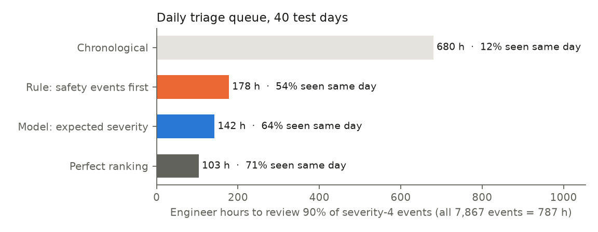
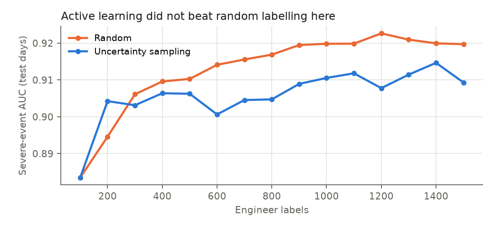
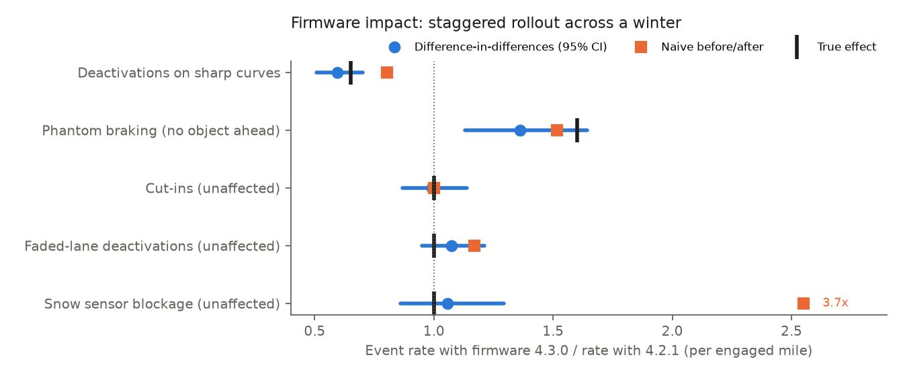

# ADAS Event Triage Lab — Fleet Events, Foundation-Model Triage, Scenario Discovery & Firmware Impact

A fleet of cars running a driver-assistance system produces thousands of events a day: driver takeovers, system
deactivations, automatic emergency braking. This lab builds the analytics behind triaging them, end to end:

- a **PySpark + Delta Lake** pipeline from raw drives and 10 Hz telemetry to event features and fleet KPIs;
- **event classifiers and a daily review queue** that put the most severe events in front of engineers first;
- an **active-learning** loop on engineer labels;
- **embeddings, HDBSCAN scenario discovery and similar-event search** (FAISS);
- a **vision-language + LLM triage** step with structured outputs, evaluated against labels and simpler baselines;
- **firmware impact** from a staggered over-the-air rollout, using difference-in-differences and a sequential monitor;
- a **FastAPI** analytics service.

**Simulated, with known truth.**
- **Fleet:** 600 vehicles, 105,096 drives over 120 days from October into January, and 21,838 events across ten
  scenarios. One scenario is a rare edge case: glare at tunnel exits, 1.1% of events.
- **Labels:** each event's true scenario, root cause and severity (1–4) are known. Severity includes reviewer
  noise, as real labels do.
- **Dashcam frames:** rendered from each event's scene, because real recorder footage isn't public.
- **Firmware:** the 4.3.0 update reaches cars in three random waves. It cuts curve deactivations to 0.65× and
  raises phantom braking to 1.6×. Winter makes rain and snow events more common over the same period, which is
  what fools naive comparisons.

Nothing here is Mercedes-Benz data.

## Pipeline

| Layer | Contents | Engine |
|---|---|---|
| bronze | drives, events (VINs pseudonymised with a salted hash), 9-channel telemetry windows as array columns | delta-rs |
| silver | 15 event features computed from the arrays with Spark higher-order functions (min TTC, peak deceleration, lane-confidence drop, visibility dip...) | PySpark |
| gold | vehicle-week engaged miles and event counts by type | PySpark |

Delta tables are written with delta-rs and read by Spark from each table's current snapshot. On Databricks or
Synapse with delta-spark, the read becomes `spark.read.format("delta")` and nothing else changes.

## Results

### Classifying events (3,480 labelled historical events → the last 40 days, 7,867 events)

| Inputs | Scenario macro-F1 | Hardest scenario | Severe-event AUC |
|---|---|---|---|
| Telemetry only | 0.942 | pedestrian crossing 0.56 (looks like a cut-in) | 0.928 |
| + frame features (classical image statistics) | **0.999** | — | 0.928 |
| + perfect scene description (upper bound for a vision model) | 1.000 | — | 0.929 |

- The camera matters most where telemetry is ambiguous: a hard brake for a pedestrian and for a cut-in look the
  same in the signals.
- Severity is noisier. Exact severity is right 68% of the time and within one level 99.5% of the time, because
  the labels themselves carry reviewer noise.
- Rendered frames are far easier than real video, so the near-perfect F1 says the pipeline works, not that real
  scenes would be this easy.

### A daily review queue (20 reviews a day: two engineer-hours)



| Order | Severity-4 events seen the same day | Engineer hours to see 90% of them |
|---|---|---|
| Chronological | 12% | 680 h |
| Rule: safety events first, by deceleration | 54% | 178 h |
| **Model: expected severity** | **64%** | **142 h** |
| Perfect ranking (ceiling) | 71% | 103 h |

The model cuts the time to see 90% of the most severe events by **79% versus chronological** and 20% versus
the rule, closing about half of the gap between the rule and a perfect ranking.

### Active learning: an honest negative



Uncertainty sampling did not beat random labelling (AUC 0.911 vs. 0.920 at 1,000 labels). Severity labels near
the decision boundary are the noisiest, so asking engineers about the most uncertain events spends labels on
cases that can't be resolved. Random labelling is the default here, and the loop stays in place to test
better strategies, such as diversity sampling or labelling by scenario.

### Scenario discovery and similar-event search

- **HDBSCAN found the rare edge case without being told to look for it.** It produced a cluster of **143 events
  that were all tunnel-exit glare** (precision 100%, recall 60%).
- **k-means missed it,** even when given the true number of scenarios (best cluster 6% precision).
- HDBSCAN split common scenarios into sub-types (26 clusters; homogeneity 0.97, completeness 0.69). That's
  useful for finding edge-case families, less useful as a summary.
- **Similar-event search** (FAISS, cosine): **96.1%** of the 10 nearest neighbours share the query's scenario
  using telemetry alone, and **99.4%** with frame features added.

### Firmware impact: the rollout ran into winter



| Event family | True effect | Naive before/after | **Difference-in-differences (95% CI)** |
|---|---|---|---|
| Curve deactivations | 0.65× | 0.80× | **0.60× (0.51–0.70)** |
| Phantom braking | 1.60× | 1.51× | **1.36× (1.13–1.64)** |
| Cut-ins | none | 1.00× | 0.99× (0.87–1.14) |
| Faded-lane deactivations | none | 1.17× | 1.07× (0.95–1.21) |
| Snow sensor blockage | none | **3.71×** | 1.06× (0.86–1.29) |

- **Comparing before and after the rollout blames the firmware for winter.** It shows 3.7× more snow blockages
  and a 17% rise in faded-lane deactivations. A raw dashboard split by firmware says 4.3.0 has *more*
  deactivations overall (6.0 vs. 5.4 per 1,000 engaged miles), although it removed 40% of curve deactivations.
- **How the comparison fixes it:** a Poisson model with week and rollout-wave fixed effects and vehicle-clustered
  standard errors compares updated and not-yet-updated cars in the same weeks. Its 95% intervals cover all five
  true effects.
- **Event labels came from the model,** trained only on events from before the rollout, as they would in
  production.
- **Early warning:** a daily monitor comparing updated and not-yet-updated cars flagged the **phantom-braking
  regression 25 days after the first wave** and the curve improvement after 28.
- **It also raised one false alarm** (snow blockage, day 83). Snow events arrive in storms, so a test that treats
  events as independent is overconfident. The difference-in-differences model, which allows for that clustering,
  shows no effect, so an alert should trigger that check before anyone acts.

### Vision-language and LLM triage: two prompt versions, scored against simpler baselines

Claude Haiku 4.5 on the same 150 test events (15 per scenario).
- **v1:** 450 calls, about 530K input tokens.
- **v2:** 450 calls, about 883K input tokens, since the retrieved examples make prompts longer. The scene
  step was re-run because the v1 scene file wasn't on the machine.
- Both runs had 0 errors. Results are in `results/llm_eval_v1.json` and `results/llm_eval_v2.json`.

**Describing the dashcam frame:** zero-shot, no labels.

| | Weather | Light | Lane markings | Objects: precision | Objects: recall |
|---|---|---|---|---|---|
| Claude vision, run 1 | 97% | 87% | 82% | 75% | 71% |
| Claude vision, run 2 | 97% | 88% | 79% | 71% | 70% |
| Classical, 3,000 labelled frames | 97% | 93% | 86% | **99%** | 64% |

The two runs differ by up to 4 points, so differences that small between prompts are noise.

**Triage:**

| Triage method | Severity exact | Severe events caught | Root cause | Scenario |
|---|---|---|---|---|
| LLM v1, telemetry card | 48% | 42% | 51% | 26% |
| LLM v1, card + scene | 52% | 54% | 69% | 67% |
| **LLM v2, card + 5 retrieved labelled examples** | **64%** | **69%** | **99%** | **87%** |
| LLM v2, card + scene + examples | 60% | 66% | 97% | **91%** |
| Keyword rules | 64% | 61% | 99% | 79% |
| Vote of the same 5 retrieved examples (no LLM) | 65% | 79% | 100% | 97% |
| LightGBM, 3,480 labels | 64% | 79% | 100% | 100% |

- **v1 was zero-shot,** and it failed for two reasons the errors showed:
  - The scenarios were named but never defined.
  - The model graded severity on its own scale, catching only 42% of severe events.
- **v2 fixed both:** it adds scenario definitions plus the five most similar *labelled* past events, retrieved by
  embedding search from history only.
  - Scenario accuracy went from 26% to 87%, root cause from 51% to 99%, and severe-event recall from 42% to 69%.
  - It now matches the rules on severity and beats them on scenario.
- **v2 still doesn't beat its control.** A plain majority vote over the same five examples scores higher
  (scenario 97%, severe recall 79%). On this data the LLM adds no classification accuracy beyond the labels it
  is shown. **So assign labels with retrieval or the supervised model, and use the LLM for what they can't do:**
  - the two-sentence narrative for engineers;
  - events with no close labelled neighbours.

  Measuring that second case is the next eval.
- **With retrieved examples in the prompt, the scene description stopped helping severity** (60% vs. 64%) while
  still helping scenario (91% vs. 87%). Extra context isn't free.
- **Example narrative (v2):** *"The vehicle initiated hard braking (5.1 m/s², 27 mph speed drop) on a rainy
  highway under an overpass with no lead object detected. The perception system likely generated a false positive
  ... triggering an unnecessary safety intervention."*

```powershell
python -m adaslab.sim; python -m adaslab.pipeline --no-spark   # first time only
$env:ANTHROPIC_API_KEY = "sk-ant-..."
python -m adaslab.llm --reuse-scenes        # prompt v2 (reuses scene outputs if results/llm_outputs*.jsonl exist)
python -m adaslab.llm --prompt v1           # reproduce v1
```

### API
`uvicorn adaslab.api:default_app --factory`:
- `/events/{id}`: the event card and expected severity
- `/events/{id}/similar`
- `/triage/queue?day=`
- `/kpi/firmware`

Ground-truth fields are never served.

## Run
```bash
pip install -r requirements.txt        # needs Java 17+ for PySpark
python -m adaslab.sim                   # data/raw (~20 s)
python -m adaslab.pipeline              # Delta bronze/silver/gold with Spark (~30 s)
                                        # no Java? --no-spark computes the same features in NumPy
                                        # (a test checks Spark and NumPy agree)
python -m adaslab.study                 # every number above -> results/study.json (~2 min)
python -m adaslab.report                # figures
pytest -q
```

## Layout
```
adaslab/
  sim.py       fleet, drives, scenarios, telemetry windows, severity, staggered firmware rollout, VIN hashing
  frames.py    rendered dashcam frames + classical image features
  pipeline.py  Delta bronze/silver/gold; Spark array features
  features.py  model matrices, telemetry-shape embedding
  triage.py    classifiers, daily queue, active learning
  discover.py  HDBSCAN / k-means discovery, FAISS similar-event search
  firmware.py  Poisson difference-in-differences, naive comparison, sequential monitor
  llm.py       vision-language scene step + LLM triage (v1, and v2 with retrieved labelled examples);
               JSON-schema tools; scoring against rules, k-NN vote and LightGBM; offline stand-ins
  api.py       FastAPI analytics service
  study.py, report.py
tests/         telemetry signatures, VIN pseudonymisation, no truth in raw files, queue metric, DiD recovery,
               event card has no truth fields, API, Spark pipeline end to end
```

## Limits
- Everything is simulated, and the frames are drawings. Real video needs a real vision model and real labels,
  and its accuracy will be lower.
- The rollout here is randomised by wave. Real rollouts often target regions or hardware first, so the wave
  fixed effects would need covariates or a synthetic-control design.
- Spark runs locally; the code has not run on Azure Synapse or Databricks.
